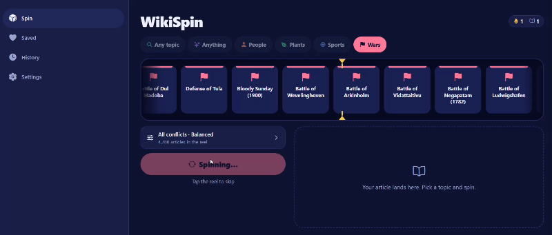
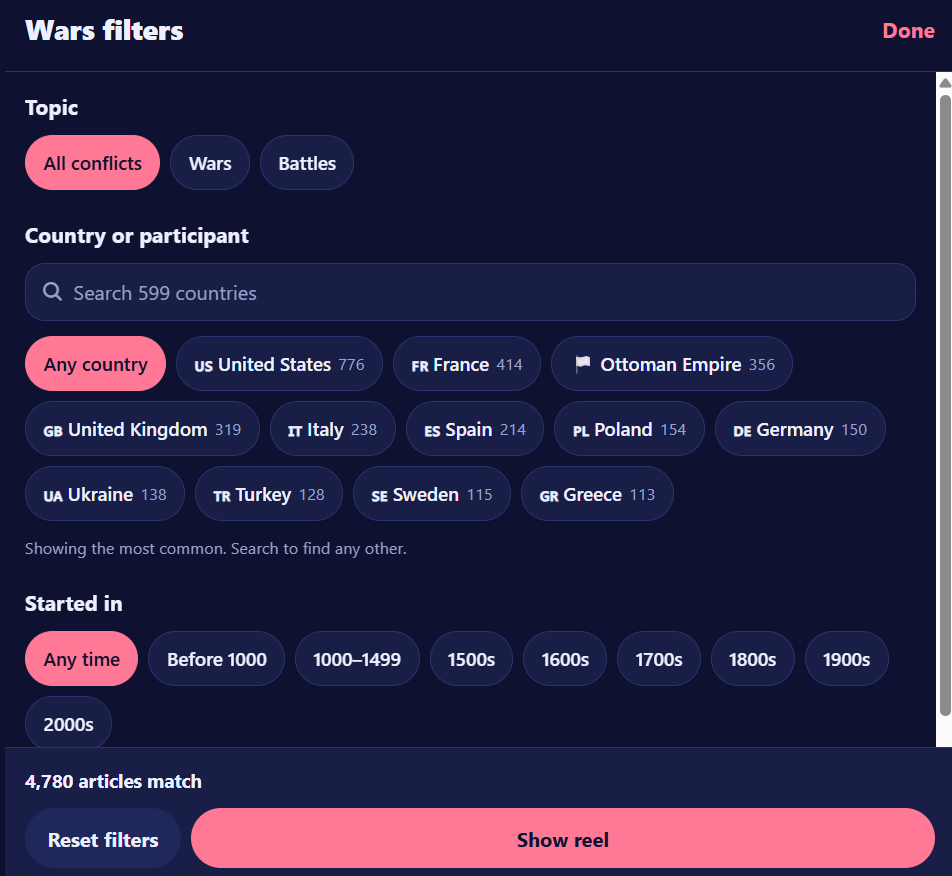
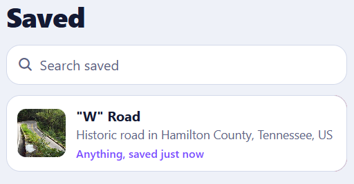

# WikiSpin

**[Open the live demo →](https://wikispin.netlify.app)** · [Download for Windows + Android](https://github.com/philofrog23-coder/wikispin/releases/latest)

**Pick a topic, spin the roulette, read something you'd never have found yourself.**

WikiSpin is a React Native + Expo app for iOS, Android, Windows and the web that turns random Wikipedia reading into a small game. Type any topic, or choose People, Plants, Sports, Wars or Anything, narrow it down by subcategory, country, era and how famous the subject is, then spin a case-opening style reel that ticks and slows down until it lands on your article.

| Spin | Result | Filters | Saved |
|---|---|---|---|
|  |  |  |  |

## Features

- **Any topic.** Type a search ("volcanoes") or pick a Wikipedia category ("Impressionist painters", subcategories included) and the reel is built live from up to 500 matching articles.
- **The reel.** 46 tiles decelerate onto a winner chosen before the animation starts. Every tile crossing the brass marker plays a synthesized tick and a light haptic tap; the stop lands at a random point inside the winning tile, overshoots slightly and settles. Tap the reel to skip.
- **Real filters on real data.** About 87,000 English Wikipedia articles in 17 bundled pools (3 MB), built from Wikidata: political leaders, writers, scientists, battles, orchid species, tournaments and more. Filter by country (722 countries and historical states), birth or start century, and a Famous ↔ Obscure slider based on how many language editions an article has.
- **A library that grows.** Online, the app quietly adds fresh randomly sampled articles from Wikidata to the categories you open (small queries, at most every 6 hours per pool, capped at 2,000 extra per pool on the device), so spins repeat less over time.
- **Anything mode** uses Wikipedia's own random-article endpoint.
- **Website and desktop.** A wide layout with side navigation on large screens; the same code ships as a website and a Windows app.
- **Saved and History** with search and swipe to delete; any card can be reopened.
- **Share cards** rendered as images.
- **Daily streak** and a running count of articles discovered.
- **Works offline** for picking: the pools are bundled, so a spin still lands on a title and the card offers to retry loading.
- **Accessible.** Reduce Motion replaces the reel with a cross-fade, VoiceOver announces the result, Dynamic Type is respected, tap targets are at least 44 pt.
- **Private.** No accounts, analytics, ads or tracking.

## Architecture

```
src/
  app/                    Expo Router routes
    (tabs)/               Spin, Saved, History, Settings (native tabs)
    filters.tsx           Filters form sheet
    article.tsx           Reopened card (modal)
  core/                   Logic with no UI
    categories.ts         Categories and subcategories as data
    filters.ts            Country / era / obscurity filtering, random pick, repeat avoidance
    spin.ts               Pick → load → retry orchestration
    spinMath.ts           Reel geometry shared by the UI thread and tests
    pools/                PoolRepository (bundled JSON pools)
    wiki/                 ArticleService (Wikipedia REST), decoding, typed errors
    sound.ts, haptics.ts  Effects
    store.ts              Zustand + AsyncStorage: settings, filters, saved, history, streak
    services.tsx          Dependency injection (swap services for mocks)
  features/               UI building blocks (reel, result card, filters, lists)
  ui/                     Theme tokens and shared controls
  data/                   Generated pools and the country table
tools/
  build-pools.mjs         Wikidata → pools generator
  make-sounds.mjs         Synthesizes tick.wav and chime.wav
  make-icon.mjs           Renders the app icon and splash assets
__tests__/                Unit tests
```

Key decisions:

- **Pools are built ahead of time.** Random sampling inside Wikipedia's category trees is slow and unreliable on a phone, so `tools/build-pools.mjs` queries the Wikidata Query Service once and writes compact JSON (`[title, sitelinks, countries, year]`). The app only calls Wikipedia at spin time to load the winning summary.
- **The winner is chosen before the animation.** The controller picks an entry, loads its summary (silently skipping 404s, disambiguation pages and pages without text, up to 5 attempts) and only then starts the reel, so the reel never lands on something that can't be shown.
- **The animation runs on the UI thread** with Reanimated. Tile crossings are detected in an animated reaction and forwarded to JS for sound and haptics.
- **Services are injected** through `ServicesProvider`, so the article service, pool repository and sound player can be replaced in tests and previews.

## Getting started

Requirements: Node 20+. The app uses native modules that aren't all in Expo Go, so run it as a development build.

With a Mac (Xcode) or Android Studio:

```bash
npm install
npx expo run:ios        # or: npx expo run:android
```

Without a Mac, build in the cloud with EAS (profiles are in `eas.json`):

```bash
npm install
npx eas-cli@latest build --profile development --platform ios   # installable on your iPhone
npx expo start --dev-client                                      # then open the dev build
```

Release builds: `npx eas-cli@latest build --profile production --platform ios`, then `npx eas-cli@latest submit --platform ios`.

```bash
npm test                # unit tests (Jest)
npm run typecheck       # TypeScript
npm run lint            # ESLint
```

## Website

```bash
npm run web:build       # static site in dist/
```

Deploy for free on Netlify: connect the GitHub repository (settings come from `netlify.toml`, so every push redeploys), or drag the `dist` folder onto Netlify Drop. Any static host works; single-page routing is handled by `public/_redirects`.

## Desktop version (Windows)

The same app runs on the desktop: the Expo web build is wrapped in Electron (`desktop/`).

```bash
npm run desktop:start   # run it in a window
npm run desktop:build   # on Windows: installer + portable .exe in desktop/dist
```

On desktop, articles open in the default browser and Share copies the link.

## Regenerating the pools

```bash
WIKISPIN_CONTACT="you@example.com" npm run build-pools
# or a subset:
WIKISPIN_CONTACT="you@example.com" node tools/build-pools.mjs --only=people.writers,wars.battles
# print the label of every Wikidata ID the queries use:
node tools/build-pools.mjs --check
```

The script is polite to the Wikidata Query Service: one query at a time with pauses, a descriptive User-Agent, and backoff on HTTP 429 and timeouts. A full run takes 30–45 minutes, mostly for sports competitions (that pool walks about 38,000 competition classes in chunks). Each pool is capped at 6,000 entries (`--max=` to change it). The script prints counts and random samples for each pool so you can sanity-check the data, and regenerates `src/data/pools/index.ts`.

To add a topic: add a pool definition in `tools/build-pools.mjs`, run it, and add a subcategory that references the pool in `src/core/categories.ts`.

### Notes on the data

- People are randomly sampled per occupation with Wikidata's `bd:sample` service, so each pool is a random slice, not the most famous people.
- "Political leaders" are people who held the office a country lists as its head of state or head of government. The broader "subclass of head of government" query includes mayors and times out.
- Plants are species from selected families (for example orchids, roses and daisies for Flowering plants; pines, oaks and palms for Trees), matched by scientific name.
- "Historical figures" is every person pool filtered to people born before 1900.
- Native region for plants is too sparse on Wikidata to filter on, so Plants only has the obscurity filter.

## Before release

1. Set `CONTACT` and `PRIVACY_POLICY_URL` in `src/core/config.ts`.
2. Set `ios.bundleIdentifier` and `android.package` in `app.json`.
3. Host `PRIVACY.md` (for example on GitHub Pages) and link it in App Store Connect.
4. See `APP_STORE.md` for the listing text, screenshot plan and privacy answers.

## Credits and licenses

- Article text: [Wikipedia](https://en.wikipedia.org), [CC BY-SA 4.0](https://creativecommons.org/licenses/by-sa/4.0/). Shown with attribution on every card and in Settings.
- Topic lists: [Wikidata](https://www.wikidata.org), [CC0](https://creativecommons.org/publicdomain/zero/1.0/).
- Sounds and icon: original, generated by the scripts in `tools/`. See `CREDITS.md`.
- WikiSpin is not affiliated with or endorsed by the Wikimedia Foundation.

Code: MIT, see `LICENSE`.
